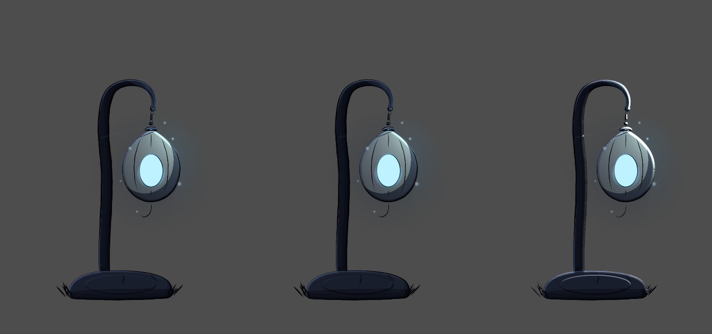
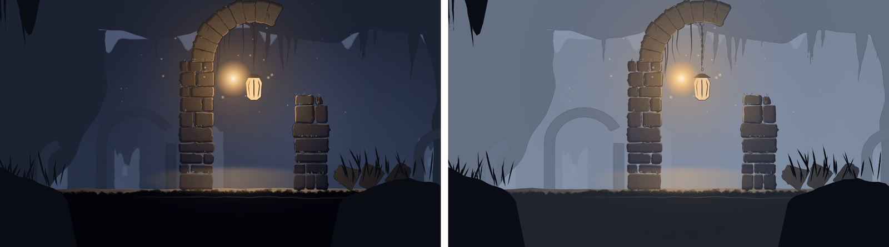

_Last updated: 2026-11-14 15:45_

# Lighting in a game

Let a game's 2D lights light your drawing. klad makes light maps from what you draw: which way each pixel faces, how shiny it is, what glows.



## Turn the maps on

1. Select **Window > Light maps** and tick **light maps**.
2. Hold **L** and move the pointer. The pointer is a light.
3. Press **M** to see each map over the canvas.

## Shape the surface

- **bevel** sets how far in from the outline the edges round over.
- Give a layer the role **height** and paint it: white raises, black lowers.
- Give a layer the role **normal** and paint directions. Pick one on the sphere in the Colour panel, or tick **direction from pen tilt** and lean the pen the way the surface faces.

## Shine and glow

In **Layer settings**, set **shine** for metal and wet things, and tick **emissive** for windows, eyes and fire. They glow whatever the light.

## Check the maps

Select **View > Check the light maps**. The Light maps panel lists what reads wrong, such as a layer that looks flat or a glow past the drawing. Click a line to go there.

## Export to Godot

Click **export to Godot**. With the maps on, the sprite is lit by Godot's lights, and `<name>_lit.tscn` shows it with your preview lights. Tick **shadows** in the export window for shadows from the silhouette. Tick a shader for fog, a rim light or darker creases.



## From a script

```sh
klad maps art.klad --on bevel=10
klad export art.klad --maps normal,specular
klad export art.klad --godot ../game/art --occluders --shaders fog
```
